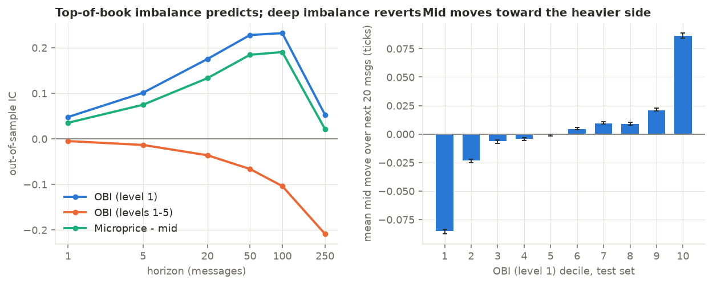
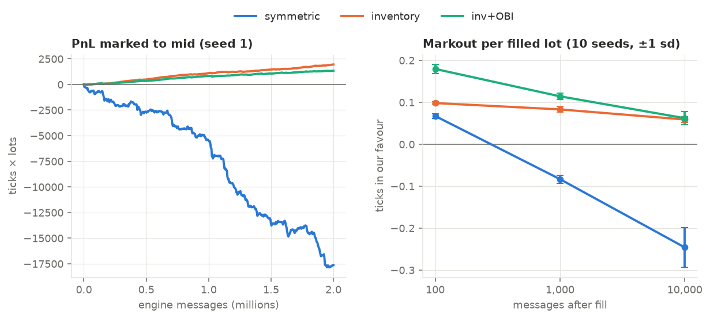

# tickforge

**A low-latency limit order book and matching engine in C++20, with a Python
research layer that uses the engine to study order book imbalance and backtest
market-making strategies.**

[](https://github.com/rakshitmeshram/tickforge/actions/workflows/ci.yml)   

| | |
|---|---|
| **Throughput** | **40.2 M msgs/s** single core, 2.5× a `std::map` book on identical flow |
| **Latency** | **p50 36 ns · p99 102 ns · p99.9 198 ns** per message (add / cancel / amend / market) |
| **Correctness** | Unit tests plus differential fuzzing: 1.4 M random messages (4.6 M in CI), including self-trade prevention across several owners, must match an independent reference book trade for trade. Clean under ASan, UBSan and `-Werror` on GCC and Clang, and built and tested with MSVC, in CI on every push |
| **Features** | GTC / IOC / FOK limits, market orders, O(1) cancel, amend, and self-trade prevention (cancel newest / oldest / both) |
| **Research** | Level-1 imbalance has an out-of-sample IC of 0.23 at 50 messages. An inventory-skewed market maker earns money where a symmetric one loses, and using the imbalance signal for quoting *reduces* PnL. The analysis shows why |

The benchmark numbers come from `scripts/reproduce.sh` on a 2-vCPU Intel Xeon @ 2.1 GHz cloud VM
(GCC 13, `-O3`) with the v1.0 flow generator; on a desktop CPU they will be better. The research numbers are deterministic (same
seed, same result on every platform) and were regenerated for v1.1, whose flow generator only
cancels and amends orders that are really resting (see [Benchmarks](#benchmarks)).

---

## Contents

```
include/tickforge/
  order_book.hpp       fast book: dense price ladder, hierarchical bitset, intrusive FIFO queues
  reference_book.hpp   std::map + std::list book with identical semantics (test oracle and baseline)
  hier_bitset.hpp      64-ary bitset: next/prev occupied price level in O(log64 N)
  id_map.hpp           open-addressing OrderId -> slot map, backward-shift deletion
  flow_generator.hpp   reproducible synthetic order flow with a hidden fair value and informed takers
  message.hpp          32-byte binary message format and file I/O
  c_api.h              exception-free C ABI
src/c_api.cpp          C ABI implementation -> libtickforge_c.so
tools/                 tf_gen (write flow), tf_replay (export book/trade CSVs), tf_bench
tests/                 scenario tests (run on both books), structure property tests, differential fuzz,
                       input validation
scripts/               reproduce.sh / reproduce.ps1, zig/ compiler wrappers for Windows without Visual Studio
.github/workflows/     CI: GCC, Clang, MSVC, sanitizers, Python, research smoke test, clang-format
python/tickforge/      ctypes bindings (numpy only), pytest suite
research/              obi_signal.py, market_maker.py, plot_latency.py
docs/DESIGN.md         design decisions and trade-offs
```

## Quick start

```bash
git clone https://github.com/rakshitmeshram/tickforge.git && cd tickforge
cmake -S . -B build -DCMAKE_BUILD_TYPE=Release && cmake --build build -j
(cd build && ctest --output-on-failure)        # C++ tests
(cd python && python3 -m pytest -q)            # Python binding tests
./build/tf_bench --n 2000000                   # benchmark vs std::map baseline
scripts/reproduce.sh                           # every number and figure below
```

Sanitizer build: `cmake -S . -B build-asan -DCMAKE_BUILD_TYPE=Debug -DTF_SANITIZE=ON`.

**Windows** (Visual Studio 2022 or MinGW-w64, CMake 3.20+), from PowerShell:

```powershell
cmake -S . -B build
cmake --build build --config Release -j
ctest --test-dir build -C Release --output-on-failure
cd python; python -m pytest -q
.\scripts\reproduce.ps1        # Windows equivalent of reproduce.sh
```

The DLL is written to `python/tickforge/` (`tickforge_c.dll` with MSVC, `libtickforge_c.dll` with
MinGW, which links its C++ runtime statically). With MSVC, warnings are not errors by default; pass
`-DTF_WERROR=ON` to make them so. MSVC sanitizer builds get AddressSanitizer only (no UBSan).

**Windows without Visual Studio.** Everything can come from pip inside a project virtual
environment, with `zig c++` (Clang) as the compiler. The wrappers in `scripts/zig/` call the zig from
`.venv`:

```powershell
python -m venv .venv
.venv\Scripts\python -m pip install ziglang cmake ninja numpy pandas matplotlib pytest
$env:PATH = "$PWD\.venv\Scripts;$env:PATH"
cmake -S . -B build -G Ninja -DCMAKE_BUILD_TYPE=Release `
  -DCMAKE_CXX_COMPILER="$PWD/scripts/zig/zig-cxx.cmd" `
  -DCMAKE_AR="$PWD/scripts/zig/zig-ar.cmd" -DCMAKE_RANLIB="$PWD/scripts/zig/zig-ranlib.cmd"
cmake --build build
ctest --test-dir build --output-on-failure
```

Once `build\` is configured this way, `reproduce.ps1` reuses it. Windows' `steady_clock` ticks every
100 ns, so latency percentiles there are coarse; throughput numbers are fine.

The engine needs only a C++20 compiler and CMake. The Python layer needs
`numpy`, and the research scripts also need `pandas` and `matplotlib`.

```python
from tickforge import OrderBook, BUY, SELL, Stp, Tif

book = OrderBook(min_price=1, max_price=19_999)
book.limit(1, SELL, 10_001, 5)
book.limit(2, SELL, 10_002, 5)
r = book.limit(3, BUY, 10_002, 7, Tif.IOC)   # Report(status=OK, filled=7, resting=0)
book.take_trades()                           # numpy structured array: maker_id, taker_id, price, qty, side

# Self-trade prevention: orders with the same non-zero owner never trade with each other.
book.limit(4, SELL, 10_003, 5, owner=7)
r = book.limit(5, BUY, 10_003, 5, owner=7, stp=Stp.CANCEL_OLDEST)  # cancels order 4 instead
book.take_self_trade_cancels()               # order_id, qty of resting orders cancelled by STP
```

## The engine

**Semantics.** Price-time priority. Limit orders support GTC, IOC and FOK (FOK checks liquidity
before touching the book). Market orders never rest. Cancel is O(1). Amend follows common exchange
rules: reducing quantity at the same price keeps queue position, while any other change is a
cancel/replace that loses priority and can trade immediately. Rejections are typed: duplicate id,
invalid price or quantity, unknown order, FOK unfillable, capacity, invalid message.

**Self-trade prevention.** Every order can carry a 32-bit owner id (0 = anonymous). An incoming
order never trades with a resting order of the same non-zero owner. Its STP mode decides what
happens instead:

| mode | resting order | incoming order |
|---|---|---|
| `CancelNewest` (default) | stays | remaining quantity cancelled, never rests |
| `CancelOldest` | cancelled | keeps matching |
| `CancelBoth` | cancelled | remaining quantity cancelled |

Fills against other owners made before the self-match stand. Quantity cancelled from the incoming
order is reported in `ExecReport::self_trade_cancelled`. Each cancelled resting order is delivered
to the trade sink as a `StpCancel` event, if the sink accepts that type (in Python:
`take_self_trade_cancels()`). FOK counts only the liquidity it could actually reach under its STP
mode. An amend that re-enters the book keeps the order's owner and mode. The owner and mode fill
what used to be padding in the 32-byte message format, so older message files still read as
anonymous. The owner is stored inside the 32-byte order node: quantities are capped at 2³⁰, so a
node's quantity fits in 32 bits. Matching for anonymous flow costs one predictable branch, and the
benchmark difference was within run-to-run noise.

**Input validation.** Quantities must be in `[1, 2^30]` (`kMaxQty`), which keeps every level and
liquidity total far from `int64` overflow. Market orders may not reuse the id of a resting order,
so every trade's taker id is unambiguous. A message whose type, side or TIF byte is out of range is
rejected with `RejectedInvalidMessage` before it touches the book, both in `apply()` and at the C
ABI. `read_messages` checks the header's record count against the file size before allocating and
validates every record, so a truncated or corrupt file fails cleanly.

**Data structures** (full reasoning in [docs/DESIGN.md](docs/DESIGN.md)):

| Problem | `std::map` baseline | tickforge |
|---|---|---|
| price → level | red-black tree, O(log L) pointer chasing | dense array indexed by `price - min_price`, O(1) |
| next best level after one empties | `begin()` of tree | 3-layer 64-ary bitset, `countr_zero`/`countl_zero`, O(log64 N) |
| FIFO at a level | `std::list`, allocation per order | intrusive doubly linked list of 32-bit pool indices, no allocation after construction |
| id → order (cancel/amend) | `std::unordered_map`, node per entry | flat open-addressing table, splitmix64, backward-shift deletion |
| trade callback | — | template parameter, inlined (no virtual call) |

**A bug the benchmark caught.** The first version sized the id hash table for `max_orders` (4M slots,
64 MB). Each cancel was then a cache and TLB miss, and p50 latency came out *worse* than the
`std::map` baseline (120 ns vs 67 ns). Sizing the table to the expected live order count and letting
it grow cut the fast book's p50 to 36 ns and doubled throughput. `BookConfig::expected_orders` is
that knob.

## Benchmarks

`tf_bench` replays an in-memory stream of 2M messages through each book. Throughput is the best of
5 untimed replays. Latency brackets every message with `steady_clock`, and the median cost of an
empty bracket (25 ns) is subtracted.

> **Generator change in v1.1.** The tables below were measured with the v1.0 generator. That
> generator never learned when its orders were filled, so it kept cancelling and amending orders that
> were already gone: 46% limit, 45% cancel, 6% market, 3% amend, with many cancels rejected as
> unknown. The v1.1 generator tracks fills, so every cancel and amend hits a live order. The mix is
> now 60% limit, 31% cancel, 6% market, 3% amend, with about 2,200 resting orders on the typical
> book. Real cancels cost more than rejected ones, so throughput on the new flow is lower for *both*
> books (about 20% on a Windows/Clang test machine). The speedup over the baseline is unchanged.
> Re-run `scripts/reproduce.sh` on the reference VM to refresh these tables.

**Typical book** (about 2,000 resting orders around the touch):

| | throughput | p50 | p90 | p99 | p99.9 |
|---|---:|---:|---:|---:|---:|
| **tickforge::OrderBook** | **40.2 M/s** | **36 ns** | **56 ns** | **102 ns** | **198 ns** |
| std::map baseline | 16.3 M/s | 68 ns | 113 ns | 210 ns | 365 ns |

Fast-book p50 / p99 by type: limit 35 / 107 ns, cancel 36 / 78 ns, market 44 / 132 ns, amend 49 / 131 ns.

**Deep, wide book** (about 200,000 resting orders spread over hundreds of levels; `--live 200000 --decay_pct 2`):

| | throughput | p50 | p99 | p99.9 |
|---|---:|---:|---:|---:|
| **tickforge::OrderBook** | **15.8 M/s** | **83 ns** | **332 ns** | **513 ns** |
| std::map baseline | 7.1 M/s | 142 ns | 646 ns | 1,068 ns |

Both slow down on the deep book because the working set no longer fits in L1/L2 cache, and the gap
holds at about 2×.


The flat region near 2×10⁻⁴ that both books share is the operating system (interrupts, scheduler
ticks on a shared VM), not the engine. Measuring below it needs core isolation, which is listed
under next steps.

## Testing

* **Scenario tests** (`test_order_book.cpp`): 19 hand-checked scenarios (37 test cases) covering priority, partial
  fills, IOC/FOK, market sweeps, amend priority rules, rejections, capacity, boundary prices, and
  every self-trade prevention mode, including FOK and amend. Every scenario runs against **both**
  books, so the oracle is pinned too.
* **Property tests** (`test_structures.cpp`): `HierBitset` against `std::set` and `IdMap` against
  `std::unordered_map`, over hundreds of thousands of random operations. The bitset is checked at
  word-boundary sizes (63/64/65/4096/4097 bits) and the map starts tiny to force repeated rehashing.
* **Differential fuzz** (`test_differential.cpp`): identical message streams go to `OrderBook` and
  `ReferenceBook`, and every `ExecReport`, every trade in order, top of book after every message and
  full depth every 64 messages must match. There are two stream sources. The adversarial one uses a
  narrow price band with duplicate and stale ids, invalid prices and quantities, and tiny capacity.
  Orders are spread over three owners plus anonymous flow with random STP modes, so self-trade
  prevention fires constantly, and `StpCancel` events must match too.
  The realistic one uses the flow generator. A further test checks that the generator never sends a
  cancel or amend for an order that is not resting, and that its live set equals the book. Set `TF_FUZZ_SEEDS` for longer runs; CI uses 200.
  *Mutation check:* flipping one comparison in best-ask maintenance makes the fuzz test fail at
  message 20, so it catches real bugs.
* **Sanitizers / warnings:** ASan + UBSan build, `-Wall -Wextra -Wconversion -Wsign-conversion
  -Wold-style-cast … -Werror`, clean on GCC 13 and Clang. CI also builds and tests with MSVC on Windows.
* **Validation tests** (`test_validation.cpp`): malformed enum bytes, the quantity cap, market-order
  id reuse and the capacity invariant on both books. Corrupt message files are covered too:
  truncated, trailing bytes, huge record count, bad magic and bad records.
  The fuzzer also injects malformed bytes, over-cap quantities and reused market ids.
* **Python:** pytest covers the FFI boundary, including generator reproducibility, id-range
  isolation, rejection of invalid sides and use of a closed book.
* **CI** ([`.github/workflows/ci.yml`](.github/workflows/ci.yml)) runs on every push: GCC and Clang,
  each in Release and in an ASan + UBSan build, MSVC Release with the Python tests, a Python job that
  also runs a research smoke test, and a `clang-format` 18 check. Before pushing, format with
  `clang-format -i include/tickforge/*.hpp src/*.cpp tools/*.cpp tests/*.cpp` (version 18, as on
  Ubuntu 24.04; `pip install clang-format==18.1.8` gives the same binary).

## Research 1 — does order book imbalance predict the mid?

`tf_replay` exports a top-5 snapshot after each of 2M messages. `research/obi_signal.py` tests three
signals against the forward mid-price move, using only data a participant could see:

* **OBI1** = (bid₁ − ask₁)/(bid₁ + ask₁) on level-1 quantities
* **OBI5**, the same ratio on top-5 quantities
* **microprice − mid**

Method: chronological 70/30 split. Scaling is fit on train only. IC is measured on test with
**non-overlapping** samples (stride = horizon), so t-stats are not inflated by overlap.

| horizon (msgs) | 1 | 5 | 20 | 50 | 100 | 250 |
|---|---:|---:|---:|---:|---:|---:|
| OBI1 IC | 0.048 | 0.101 | 0.175 | **0.228** | **0.232** | 0.053 |
| microprice IC | 0.035 | 0.075 | 0.133 | 0.185 | 0.190 | 0.022 |
| OBI5 IC | −0.005 | −0.014 | −0.036 | −0.066 | −0.104 | **−0.209** |



Findings:

* Level-1 imbalance is strongly predictive out of sample: t ≈ 30 at 20 messages on 30k independent
  samples. When signal and move are both non-zero, the sign is right 73% of the time.
* Deep imbalance has the **opposite** sign. When the hidden fair value moves, orders placed for the
  old price stay behind on the side the price moved away from. Top-5 depth then piles up on the
  wrong side and works as a contrarian indicator.
* Microprice carries the same information as OBI1 but is slightly weaker, because it is OBI1 scaled
  by a spread that is almost always one tick.

*Caveat:* the flow is synthetic, and the generator's informed takers are what make imbalance
predictive. The point of the exercise is the methodology (no leakage, honest sample counts) and the
tooling, not a claim about real markets.

## Research 2 — market making against the live engine

`research/market_maker.py` places a market maker's quotes **into the same C++ book** that the
synthetic flow trades against, through the ctypes API. Quotes queue behind existing liquidity, fill
only when takers reach them, and get adversely selected by informed flow. Nothing is filled at mid
or by assumption. Every strategy uses 5-lot quotes, a ±50-lot position limit, post-only pricing,
and a cancel/replace only when the price changes, so unchanged quotes keep their queue position.

* **symmetric**: quotes around the mid.
* **inventory**: Avellaneda–Stoikov-style reservation price r = mid − κ·q.
* **inv+OBI**: r = mid − κ·q + β·OBI1, leaning on Research 1's signal.

κ and β were tuned on seeds 101–103 only, with the v1.0 generator, and were not re-tuned after the
v1.1 fix. The table reports seeds 1–10, which were never used for tuning: 30 runs and 60.6M engine
messages (161 s on a Windows/Clang test machine).

| | PnL (ticks×lots) | Sharpe / √1k steps | filled lots | mean \|inv\| | markout 100 | markout 1k | markout 10k |
|---|---:|---:|---:|---:|---:|---:|---:|
| symmetric | −14,632 ± 4,537 | −0.63 | 55,759 | 24.8 | +0.07 | −0.08 | −0.25 |
| **inventory** | **+1,403 ± 314** | **+0.48** | 22,694 | **2.4** | +0.16 | +0.11 | **+0.06** |
| inv+OBI | −2,266 ± 295 | −0.79 | 6,217 | 2.6 | **+0.41** | +0.02 | −0.34 |

(± is the standard deviation across 10 seeds. Markout is the mid move in our favour per filled lot,
N messages after the fill.)



Findings:

* **Inventory control is the difference between losing and earning.** The symmetric maker sits at
  its position limit most of the time (mean |inv| 25 of 50) and bleeds as informed flow pushes the
  price through it. Skewing quotes by inventory keeps |inv| near 2 and turns PnL positive in every
  seed (+794 to +1,833).
* **A predictive signal made things worse, and markouts show why.** Leaning on OBI raises the
  100-message markout from 0.16 to 0.41, so the fills look great short-term. By 10k messages the
  same fills are −0.34. The signal selects fills that are good over the signal's horizon (Research 1:
  IC peaks at 50–100 messages) and does nothing about the slower informed drift. Chasing the signal
  also reprices quotes, which forfeits queue position, and filled volume drops by 73%.
* The accounting is checked: final PnL equals Σ fills × (final mid − fill price) exactly.

## What this is not

Being clear about scope matters more than overclaiming:

* **Single-threaded, single instrument.** That is deliberate: a matching engine is a sequential state
  machine, and real systems scale by sharding instruments across cores. There is no network gateway
  (FIX/OUCH), no persistence or journaling, and no market data publisher.
* **Synthetic data.** The flow generator is a stylised model chosen to be reproducible. Running the
  research on real data (for example LOBSTER/ITCH files) is the obvious extension. `tf_replay`
  already consumes a binary message format, so this only needs a parser.
* **Latency numbers include a ~25 ns clock-read correction** and come from a shared cloud VM without
  core isolation.

## Next steps

* Refresh the benchmark tables with the v1.1 generator on the reference VM.
* Re-tune the market maker's κ and β on the v1.1 flow (tuning seeds 101–103 only).
* An ITCH 5.0 parser so the same engine and research run on real NASDAQ sample data.
* `rdtsc`-based timing with core pinning and isolation for sub-10 ns measurement resolution.
* A lock-free SPSC ring buffer between a gateway thread and the matching thread.
* Queue-position-aware fill modelling and a fee/rebate model for the market maker.

## License

MIT
